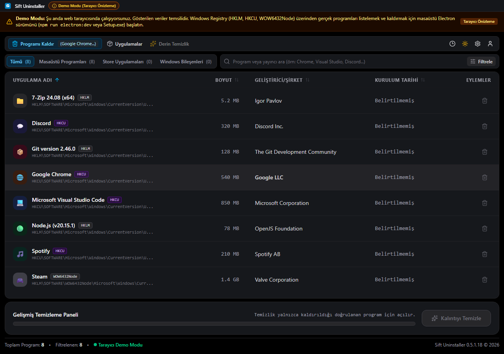
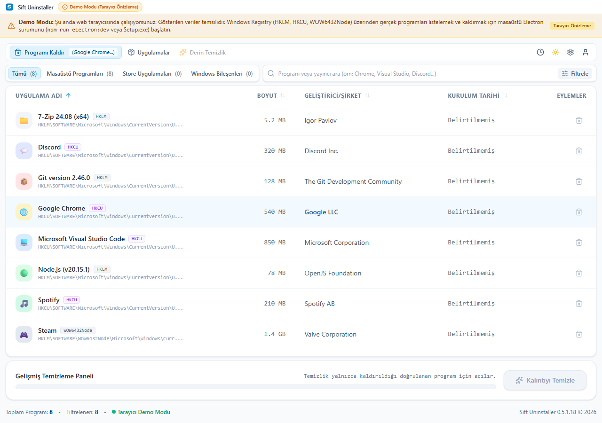
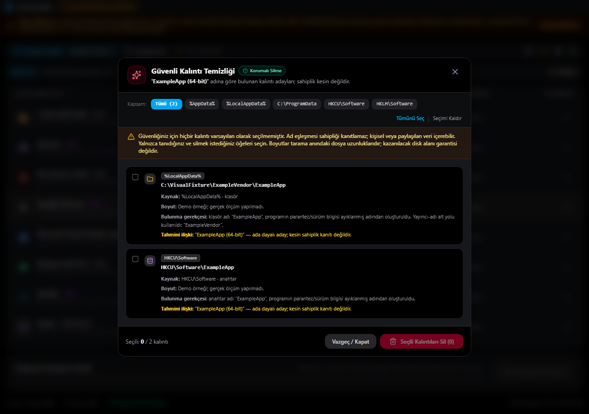

# Sift Uninstaller

Your Windows software, organized. Uninstall apps and review what they leave behind.

[Download for Windows](https://github.com/canok07/sift-uninstaller/releases/download/v0.5.1.18/Sift.Uninstaller-Setup-0.5.1.18.exe) · [English](#english) · [Türkçe](#türkçe)

## English

Sift brings desktop programs, Microsoft Store apps and Windows components into one clear view. Find an app, launch its uninstaller, then review leftover files and Registry entries after removal is verified.

- Separate categories, quick search and sorting.
- Native Windows uninstalling with removal checks.
- Leftover review: you choose what to delete.
- Cleanup backups, operation history and local error logs.
- Light and dark themes.

Windows 10/11 x64 · **0.5.1.18** · Setup EXE · No Node.js required

Unsigned development release; real MSI, recovery/reinstall and installer acceptance tests remain pending. Name-based leftover matches need your review. General Temp cleaning and RAM optimization are not included.

### Screenshots

Demo/sample data from the current interface, not a real uninstall or cleanup.

| Light theme | Review before cleanup |
| --- | --- |
|  |  |

[Detailed guide](docs/GUIDE.md) · [Verification](docs/VERIFICATION.md) · [Report a problem](https://github.com/canok07/sift-uninstaller/issues)

---

## Türkçe

Windows'taki programlarınız tek yerde. **Sift**, masaüstü programlarını, Store uygulamalarını ve Windows bileşenlerini düzenli bir listede gösterir. Programı kaldırın; kaldırıldığı doğrulandıktan sonra kalan dosya ve Registry adaylarını inceleyip seçerek temizleyin.

- Ayrı kategoriler, hızlı arama ve sıralama.
- Windows üzerinden kaldırma ve sonrasında doğrulama.
- Kalıntıları inceleme; neyin silineceğine siz karar verirsiniz.
- Temizlik yedekleri, işlem geçmişi ve yerel hata kayıtları.
- Açık ve koyu tema.

Windows 10/11 x64 · **0.5.1.18** · Kurulum EXE'si · Node.js gerekmez

[Kurulum dosyasını indir](https://github.com/canok07/sift-uninstaller/releases/download/v0.5.1.18/Sift.Uninstaller-Setup-0.5.1.18.exe) · [Ekran görüntüleri](#screenshots)

İmzasız geliştirme sürümüdür; gerçek MSI, geri alma/yeniden kurulum ve kurulum kabul testleri tamamlanmadı. Kalıntılar ad eşleşmesine dayanır; silmeden önce inceleyin. Genel Temp temizliği ve RAM optimizasyonu içermez. Görseller örnek verilerle alınmıştır; gerçek temizlik kanıtı değildir.

[Ayrıntılı rehber](docs/GUIDE.md#türkçe) · [Doğrulama bilgileri](docs/VERIFICATION.md) · [Sorun bildirin](https://github.com/canok07/sift-uninstaller/issues)
